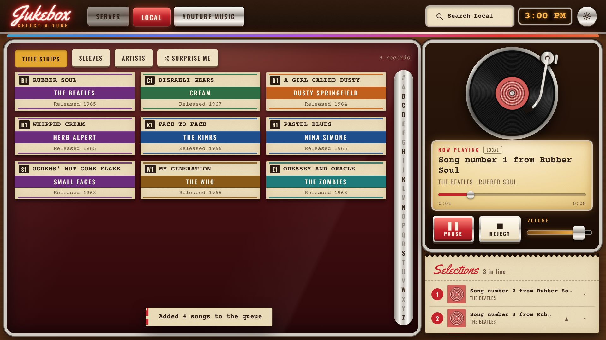

# Jukebox

A touchscreen jukebox for big screens (built for a 55" panel), in a 1950s/60s cabinet style.
It plays from a **Jellyfin** server, **local music folders** and **YouTube Music**, all into one queue.



## Download
Get the latest files from **[Releases](../../releases/latest)**:

| System | File |
|---|---|
| Windows (installer) | `Jukebox-Setup-1.2.0.exe` |
| Windows (no install) | `Jukebox-1.2.0-portable.exe` (doesn't auto-update) |
| Linux (any distro) | `Jukebox-1.2.0.AppImage`, then `chmod +x` it and run |
| Debian / Ubuntu | `jukebox_1.2.0_amd64.deb`, then `sudo apt install ./jukebox_1.2.0_amd64.deb` |

Installed copies **update themselves** from this repo's releases. A new version downloads in the background and installs when nothing is playing (or between 3 and 5 am), and the queue carries on afterwards. You can turn this off in Settings → Updates. The Windows installer and the AppImage update silently; the .deb asks for the admin password.

These builds aren't signed, so Windows SmartScreen will warn the first time: click **More info → Run anyway**.

## Setup
Tap ⚙ (top right):
- **Jellyfin:** enter the server address (e.g. `http://192.168.1.10:8096`), username and password
- **Local folders:** add a folder, and the app scans its tags and cover art
- **YouTube Music:** works straight away (with ads); sign in with a Premium account to remove them
- **Operator PIN:** set one so guests can't change settings

Operator keys: `F11` toggles fullscreen, `Ctrl+Shift+Q` quits (also in kiosk mode).

## Building and publishing a new version
The app source is in this repo. To release:
```
git tag v1.2.1
git push --tags
```
The **release** workflow (`.github/workflows/build.yml`) then builds Windows and Linux and publishes them here as a release, and every installed jukebox picks it up automatically. Ordinary commits don't trigger a build. You can also start it from the Actions tab ("Run workflow"), which uses the version in `package.json`.

Local development:
```
npm install
npm start
```
Config and library cache are stored in `%APPDATA%\Jukebox` (Windows) or `~/.config/Jukebox` (Linux).
